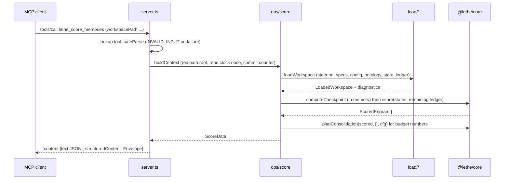
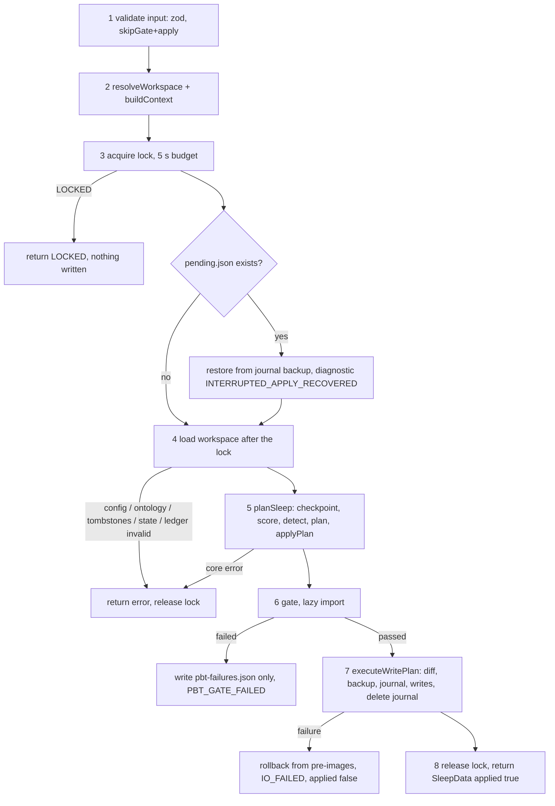
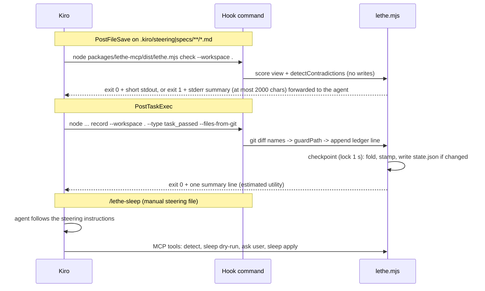

# Design Document

## Overview

`lethe-mcp` is the imperative shell around the pure `@lethe/core` engine. It is the only package that touches the filesystem, git, the clock, process streams, and the network boundary (there is none). It ships one self-contained file, `dist/lethe.mjs`, that is both the MCP stdio server (`lethe serve`) and the `lethe` CLI used by Kiro hooks.

The package is organised as **transport-agnostic operations** (`src/ops/*`) that take a `RunContext` and return a result envelope, wrapped by two thin transports: four MCP tools (`src/tools/*`) and the CLI (`src/cli/*`). Operations are built on a small IO layer (`src/io/*`), a loader (`src/load/*`) that turns disk into core inputs, and a persistence layer (`src/persist/*`) that turns core outputs into guarded, atomic, recoverable writes.

### Decisions at a glance

| # | Decision | Why |
|---|---|---|
| M1 | Low-level `Server` from `@modelcontextprotocol/sdk` **1.32.2** with our own `tools/list` and `tools/call` handlers, not `McpServer.registerTool` | Verified: `McpServer` converts input-validation failures and unknown tool names into plain-text `isError` results. Requirements 1.5, 6.1, and 6.6 need an Envelope with `INVALID_INPUT` and a JSON-RPC error for unknown tools. |
| M2 | zod **4.6.7**, JSON Schema for `tools/list` from `z.toJSONSchema(schema, { io: "input" })`; no `outputSchema` | Verified output has `additionalProperties: false` for `.strict()` schemas. Without `outputSchema`, clients do not run per-call output validation, and `data` can stay per-tool. |
| M3 | `state.json` stores **checkpointed post-replay states plus a Ledger cursor**; every write is a full checkpoint (fold, stamp, prune) | Fixes double-counted reinforcement (P-A) and gives never-persisted engrams a first-seen moment (P-B). See "State Model". |
| M4 | esbuild **0.28.2**, single bundle, no source maps, committed, LF-normalised drift test | Core exports `.ts` sources, Bun is absent on the maintainer's machine. Measured: 1.57 MB, handshake about 115 ms. |
| M5 | The gate (`@lethe/core/properties` plus `fast-check`) is bundled but imported lazily | Measured: `fast-check` adds about 414 KB to the file and about 150 ms on first use, and nothing at startup. |
| M6 | Operations compose core's public functions (`parseDocument`, `score`, `detectContradictions`, `planConsolidation`, `applyPlan`, `resurrect`) instead of calling `runConsolidation` | `runConsolidation` takes no user ontology, so `ontology.json` would be ignored by `sleep`. Two small core additions are required (see "Core Follow-ups"). |
| M7 | Crash safety by journal (`pending.json`) plus pre-image backup | Requirement 8.10: a killed apply is rolled back by the next mutating operation. |

### Verified SDK facts and differences from the requirements

Verified on 2026-11-09 against the npm registry (`latest` = 1.32.2), the `v1.x` branch README, `docs/server.md`, `src/server/mcp.ts`, `src/inMemory.ts`, and a local probe bundle. Also recorded in `06-memory.md`.

| Fact | Consequence |
|---|---|
| The `main` branch is **v2** (`@modelcontextprotocol/server`, `@modelcontextprotocol/client`, Standard Schema). `@modelcontextprotocol/sdk` 1.32.2 is the v1.x maintenance line, supported at least six months after 2026-07-27. | Stay on v1.x, matching ADR D4 and `03-rules` section 8. Migration to v2 is a later, separate decision. |
| Peer `zod ^3.25 \|\| ^4.0`; the SDK imports `zod/v4` internally. | Pin zod 4.6.7 exactly. |
| `McpServer.registerTool(name, { title?, description?, inputSchema?, outputSchema?, annotations? }, cb)`; failures inside the call handler, including `McpError` for unknown tools and input validation, are returned as `{ content: [{ type: "text", text }], isError: true }`. | **Differs from requirements 1.5 and 6.6.** Requirement 1.5 is amended to a JSON-RPC `-32602` error and the server uses the low-level `Server`. |
| Imports: `@modelcontextprotocol/sdk/server/index.js` (`Server`), `.../server/stdio.js` (`StdioServerTransport`), `.../types.js` (`CallToolRequestSchema`, `ListToolsRequestSchema`, `McpError`, `ErrorCode`), `.../client/index.js` (`Client`), `.../inMemory.js` (`InMemoryTransport.createLinkedPair()`). Verified by dynamic import under Node. | Contract tests use `Client` plus `InMemoryTransport`. |
| Tool results: `{ content, structuredContent?, isError? }`. | Matches requirement 1.3. |
| The package `exports` map includes `"./*"` mapping to `dist/esm/*`. | Deep imports with explicit `.js` work and bundle. |

## Architecture

### Package layout

```
packages/lethe-mcp/
├─ package.json                  # bin, scripts, pinned deps (see Packaging)
├─ scripts/
│  ├─ build.mjs                  # esbuild JS API; writes dist/lethe.mjs
│  └─ print-mcp-config.mjs       # prints a user-level mcp.json block with an absolute path (A4 fallback)
├─ dist/lethe.mjs                # committed build output
├─ src/
│  ├─ index.ts                   # public exports: schemas, createLetheServer, runCli, types
│  ├─ cli.ts                     # process entry: argv -> runCli -> exit code
│  ├─ server.ts                  # createLetheServer(): Server + 2 handlers + stderr logger
│  ├─ envelope/
│  │  ├─ envelope.ts             # Envelope, ok(), fail(), summary normaliser, JSON text builder
│  │  ├─ diagnostics.ts          # Diagnostic type and DiagnosticCode union
│  │  └─ errors.ts               # ToolError, mapCoreError(), fromUnknown()
│  ├─ tools/
│  │  ├─ tool.ts                 # ToolDef<I, D> interface
│  │  ├─ registry.ts             # TOOLS: exactly four entries (a test fails on a fifth)
│  │  ├─ schemas-common.ts       # WorkspacePath, IsoInstant, Commit
│  │  ├─ score-memories.ts       # lethe_score_memories: schema, description, run
│  │  ├─ detect-contradictions.ts
│  │  ├─ consolidate-sleep.ts
│  │  └─ resurrect-engram.ts
│  ├─ ops/                       # transport-agnostic; shared by tools and CLI
│  │  ├─ context.ts              # RunContext, buildContext()
│  │  ├─ score.ts   detect.ts   sleep.ts   resurrect.ts
│  │  ├─ adopt.ts   record.ts   probe.ts
│  │  └─ mutate.ts               # withMutation(): lock -> recover -> load -> run -> unlock
│  ├─ load/
│  │  ├─ workspace.ts            # loadWorkspace(): orchestrates the loaders below
│  │  ├─ steering.ts             # collect .kiro/steering/**/*.md into a files Map + parse -> EngramNode[]
│  │  ├─ specs.ts                # SpecInvariant derivation (requirement 10.3)
│  │  ├─ config-file.ts   ontology-file.ts   state-file.ts
│  │  ├─ ledger-file.ts          # read, split lines, validate, cursor check
│  │  ├─ tombstone-file.ts
│  │  └─ commit-counter.ts       # override > git > state > ledger > zero
│  ├─ persist/
│  │  ├─ stable-json.ts          # key-ordered JSON text (2 spaces, LF, trailing newline)
│  │  ├─ checkpoint.ts           # pure: fold, stamp, prune, cursor (State Model)
│  │  ├─ state-serialize.ts
│  │  ├─ ledger-append.ts
│  │  ├─ write-plan.ts           # ordered writes + backup + rollback executor
│  │  ├─ journal.ts              # pending.json write, read, recover
│  │  └─ pbt-failures.ts
│  ├─ gate/
│  │  └─ gate.ts                 # GateRunner type, lazy default runner
│  ├─ io/
│  │  ├─ path-guard.ts           # guardPath, resolveWorkspace
│  │  ├─ workspace-fs.ts         # the only module that imports node:fs for workspace files
│  │  ├─ atomic-write.ts
│  │  ├─ lock.ts
│  │  ├─ backup.ts
│  │  ├─ git.ts                  # execFile wrapper
│  │  ├─ child-env.ts            # scrubbed environment for child processes
│  │  └─ stdout.ts               # the single module allowed to write to stdout
│  └─ cli/
│     ├─ args.ts   exit-codes.ts   render.ts   run.ts
│     └─ commands/ check.ts record.ts score.ts sleep.ts resurrect.ts adopt.ts probe.ts serve.ts
└─ test/                         # see Testing Strategy
```

Every file stays at or below 200 lines and every function at or below 40 lines (`03-rules` section 3). Where a table in this document would exceed that when implemented (for example the Windows segment rules), split into a sibling file (`path-guard-win.ts`).

### Layering rules

```mermaid
flowchart TD
  CLI[cli/*] --> OPS[ops/*]
  TOOLS[tools/*] --> OPS
  SERVER[server.ts] --> TOOLS
  OPS --> LOAD[load/*]
  OPS --> PERSIST[persist/*]
  OPS --> GATE[gate/*]
  LOAD --> IO[io/*]
  PERSIST --> IO
  OPS --> CORE[[@lethe/core]]
  LOAD --> CORE
  PERSIST --> CORE
  GATE -. lazy import .-> COREP[[@lethe/core/properties]]
```

- Only `io/workspace-fs.ts` imports `node:fs` for workspace files; every call takes a path produced by `guardPath` (requirement 7.1). A grep test asserts this.
- Only `io/stdout.ts` references `process.stdout` (requirement 19.2). `server.ts` hands the SDK a `StdioServerTransport`, which owns the protocol stream; logging goes through `console.error`-backed `log()` in `server.ts`.
- `@lethe/core` is the only place with scoring, detection, planning, parsing, and tombstone logic. `ops/*` reads `Date`, git, and files, then passes `nowCommit` and `nowISO` explicitly (requirement 11.5).

### RunContext

```ts
export interface RunContext {
  readonly root: string;                 // realpath of the workspace (confinement root for the whole call)
  readonly nowCommit: number;
  readonly commitSource: "override" | "git" | "state" | "ledger" | "zero";
  readonly nowISO: string;               // clock read once per invocation
  readonly diagnostics: Diagnostic[];    // append-only collector, returned in data.diagnostics
  readonly gate: GateRunner;             // injectable for tests
  readonly git: GitRunner;               // injectable for tests
  readonly fsx: WorkspaceFs;             // bound to `root`
}
export function buildContext(input: ContextInput): Promise<Result<RunContext, ToolError>>;
```

`buildContext` resolves the workspace, reads `now` once, and resolves the Commit_Counter (override, git, state, ledger, zero). Its ordering of fallbacks is requirement 11.2; the `state` and `ledger` fallbacks need the loaded files, so `buildContext` reads only the two small inputs it needs (`state.json` `commit`, highest ledger `commit`) before the full load.

## Data Models

### Common types

```ts
export type DiagnosticCode =
  | "PARSE_SKIPPED" | "FILE_TOO_LARGE" | "FILE_NOT_UTF8"
  | "LEDGER_TORN_TAIL" | "LEDGER_LINE_SKIPPED" | "LEDGER_REWRITTEN"
  | "FIRST_SEEN_SYNTHESISED" | "COMMIT_BEFORE_CHECKPOINT" | "GIT_COMMIT_COUNT_UNAVAILABLE"
  | "GIT_FILES_UNAVAILABLE" | "FILES_TRUNCATED" | "STATE_NOT_UPDATED"
  | "INTERRUPTED_APPLY_RECOVERED" | "PATH_DROPPED";
export interface Diagnostic { readonly file?: string; readonly code: DiagnosticCode; readonly message: string }

export type ToolErrorCode = ErrorCode | "INVALID_INPUT" | "LOCKED" | "IO_FAILED" | "INTERNAL_ERROR";
export interface ToolError { readonly code: ToolErrorCode; readonly message: string; readonly detail?: unknown }

export type Envelope<D> =
  | { readonly ok: true; readonly summary: string; readonly data: D }
  | { readonly ok: false; readonly summary: string; readonly error: ToolError };
```

`summary` is normalised by `envelope.ts`: newlines and runs of whitespace collapse to one space, then it is cut at 400 characters with a trailing `…` only when cut. The GIT message is literally `git commit count unavailable` (requirement 11.2).

### Tool input schemas (zod 4, all `.strict()`, exported from `src/index.ts`)

```ts
// schemas-common.ts
export const WorkspacePath: z.ZodString;   // string, 1..4096 chars, refine: path.isAbsolute (win32 or posix style) and no NUL
export const IsoInstant: z.ZodString;      // regex: YYYY-MM-DDTHH:mm:ss(.fff)?(Z|±HH:mm) plus Date.parse(...) is finite
export const Commit: z.ZodNumber;          // int, >= 0, <= Number.MAX_SAFE_INTEGER

// score-memories.ts
export const ScoreMemoriesInput = z.object({
  workspacePath: WorkspacePath,
  atCommit: Commit.optional(),
  now: IsoInstant.optional(),
  includeSpecs: z.boolean().default(false),
}).strict();

// detect-contradictions.ts
export const DetectContradictionsInput = z.object({
  workspacePath: WorkspacePath,
  scope: z.enum(["steering-vs-specs", "all"]).default("all"),
  atCommit: Commit.optional(),
  now: IsoInstant.optional(),
}).strict();

// consolidate-sleep.ts
export const ConsolidateSleepInput = z.object({
  workspacePath: WorkspacePath,
  apply: z.boolean().default(false),
  budgetTokens: z.number().int().min(1).optional(),
  skipGate: z.boolean().default(false),
  gateRuns: z.number().int().min(1).max(10000).default(100),
  atCommit: Commit.optional(),
  now: IsoInstant.optional(),
}).strict().superRefine(/* issue "skipGate cannot be combined with apply" when both true -> INVALID_INPUT */);

// resurrect-engram.ts
export const ResurrectEngramInput = z.object({
  workspacePath: WorkspacePath,
  query: z.string().min(1).max(500),
  apply: z.boolean().default(false),
  atCommit: Commit.optional(),
  now: IsoInstant.optional(),
}).strict();
```

Zod failures are mapped to `INVALID_INPUT` with `detail: Array<{ path: string; message: string }>` and nothing else (requirement 6.6). The semantic check "`workspacePath` names an existing directory" runs in `resolveWorkspace` and also yields `INVALID_INPUT`.

### Tool output types

```ts
export type FirstSeen = "persisted" | "synthesised";
export interface ScoredEngramView {
  readonly node: Omit<EngramNode, "body" | "span">;
  readonly state: EngramState; readonly deltaC: number; readonly weight: number;
  readonly retention: number; readonly rawRetention: number;
  readonly tier: Tier; readonly status: EngramStatus; readonly protected: boolean;
  readonly firstSeen: FirstSeen;
}
export interface ScoreData {
  readonly engrams: readonly ScoredEngramView[];            // ascending node.id
  readonly tiers: { readonly hot: number; readonly warm: number; readonly crypt: number };
  readonly hotTokens: number; readonly budget: number; readonly budgetStatus: "ok" | "budget_infeasible";
  readonly commit: number; readonly commitSource: RunContext["commitSource"]; readonly now: string;
  readonly diagnostics: readonly Diagnostic[];
}
export interface DetectData {
  readonly reports: readonly ContradictionReport[]; readonly count: number; readonly unresolvable: number;
  readonly diagnostics: readonly Diagnostic[];
}
export interface SleepData extends SleepConsolidationResult {
  readonly commit: number; readonly commitSource: RunContext["commitSource"]; readonly now: string;
  readonly skipped: ReadonlyArray<{ readonly id: string; readonly reason: string }>;
  readonly checkpoint: { readonly stamped: readonly string[]; readonly foldedEvents: number; readonly pruned: readonly string[] };
  readonly gateFailure?: { readonly propertyId: string; readonly seed: number; readonly counterexample: unknown };
  readonly backupPath?: string; readonly diagnostics: readonly Diagnostic[];
}
export interface ResurrectData {
  readonly matches: readonly TombstoneRecord[];
  readonly restored?: ReadonlyArray<{ readonly id: string; readonly file: string; readonly placement: ResurrectResult["placement"] }>;
  readonly commit: number; readonly now: string; readonly backupPath?: string; readonly diagnostics: readonly Diagnostic[];
}
```

`budgetStatus` and `budget` in `ScoreData` come from running core's `planConsolidation` on the scored set (a pure call whose result is not applied), so the score tool reports the same budget state a sleep dry-run would.

### On-disk formats

All JSON files: fixed key order exactly as listed, 2-space indent, `\n` line endings, trailing newline, produced by `persist/stable-json.ts` from an explicit key-order list per file kind (requirement 8.8). Tombstones use core's `serializeTombstones`.

**`.kiro/lethe/config.json`** (zod strict)

```json
{ "version": 1, "s0": 5, "sMax": 120, "sMin": 0.5, "beta": 0.5, "alpha": 0.25, "wDefault": 1, "wSpec": 4,
  "specFloor": 0.5, "hotMin": 0.6, "cryptMax": 0.25, "budgetTokens": 4000, "dedupeJaccard": 0.85,
  "granularity": "section", "activeSpecs": ["lethe-core"] }
```

Every key except `version` is optional. The loader checks types with zod, merges over `DEFAULT_CONFIG`, then calls core's `validateConfig` for ranges. `CONFIG_INVALID` messages name the file and the key.

**`.kiro/lethe/ontology.json`**

```json
{ "version": 1, "axes": [ { "id": "string", "description": "string",
  "stances": [ { "id": "ns:name", "label": "string", "patterns": ["regex source"], "negationAware": true } ] } ] }
```

Patterns are strings (core compiles them with the `i` flag). Structure is validated by zod; regex validity by core (`ONTOLOGY_INVALID_PATTERN`).

**`.kiro/lethe/state.json`** (version 1, extended; see State Model)

```json
{ "version": 1, "commit": 148, "at": "2026-11-20T10:00:00Z",
  "ledger": { "lines": 12, "bytes": 1534, "lastLineSha256": "9f…" },
  "engrams": { "<id>": { "stability": 7.5, "lastReinforcedCommit": 100, "lastReinforcedAt": "2026-11-12T09:00:00Z", "reinforcements": 1 } } }
```

`lastLineSha256` is `null` when `lines` is 0. Zod constraints: `stability` finite and greater than 0; commits are non-negative integers; `reinforcements` a non-negative integer; `lastReinforcedAt` an `IsoInstant`. Keys of `engrams` ascend by code-unit order.

**`.kiro/lethe/ledger.jsonl`** one object per line, key order `type, at, commit, filesTouched, cited` (absent optional keys omitted), validated into core's `LedgerEvent`.

**`.kiro/lethe/lock`** `{ "pid": 4242, "host": "DESKTOP-X", "startedAt": "2026-11-09T10:00:00.000Z", "token": "hex16" }`. `token` is the owner's random identity; release deletes the file only when the stored token still equals the owner's.

**`.kiro/lethe/pending.json`** (the Journal)

```json
{ "version": 1, "startedAt": "2026-11-09T10:00:00.000Z", "pid": 4242, "backupDir": ".kiro/lethe/backup/148",
  "files": [ { "path": ".kiro/crypt/tombstones.json", "existed": false }, { "path": ".kiro/steering/03-rules.md", "existed": true } ] }
```

**`.kiro/lethe/probe/<YYYYMMDDTHHMMSSmmmZ>-<event>.json`**

```json
{ "receivedAt": "…Z", "argv": ["probe", "--workspace", "."], "cwd": "…", "stdinRaw": "…", "stdinParsed": { } }
```

`stdinParsed` is present only for valid JSON. `<event>` is `hook_event_name` reduced to `[A-Za-z0-9]` (max 40 chars) or `unknown`. No environment is captured. `stdinRaw` is capped at 1 MiB; the read gives up after 2000 ms.

**`.kiro/lethe/pbt-failures.json`** is produced only by core's `appendPbtFailure(existingText, pbtFailureEntry(failure, nowISO))`.

## State Model (resolves P-A and P-B)

### What core does (read from `src/decay/score.ts`, `reinforce.ts`, `delta.ts`)

1. `score()` keeps events with `commit <= nowCommit`, then for each engram starts from the supplied `EngramState` (or synthesises `{ stability: s0, lastReinforcedCommit: nowCommit, lastReinforcedAt: nowISO, reinforcements: 0 }`) and applies every matching event in order with `reinforce()`.
2. `reinforce()` multiplies stability by `1 + beta` (capped at `sMax`), increments `reinforcements`, and keeps the **later** of the stored and event commit and instant. Core has no notion of "already applied".
3. The `ScoredEngram.state` field is the **post-replay** state. This is the value an IO layer is tempted to persist.
4. `deltaC = max(0, nowCommit - lastReinforcedCommit) + alpha * days`, `R = exp(-deltaC / (S * W))`.

### P-A: double-counted reinforcement (worked example)

Setup: defaults (`s0 = 5`, `beta = 0.5`, `alpha` irrelevant because all instants equal), unprotected engram `E` with glob `apps/web/**`, stamped at commit 90 with `S = 5`. One ledger event `e1 = task_passed, commit 100, files [apps/web/a.ts]`.

**Naive model** (persist `ScoredEngram.state`, replay the full ledger on every call):

| Step | Replay | Persisted/used state | R at commit 112 (Δc = 12) | Tier |
|---|---|---|---|---|
| Apply at 100 | e1 | S = 7.5, last = 100, n = 1 | n/a | |
| Call at 112 | e1 again (100 ≤ 112) | S = 11.25, last = max(100, 100) = 100, n = 2 | exp(−12 / 11.25) = 0.344 | Warm |
| Apply at 112 persists that, call again | e1 again | S = 16.875, n = 3 | exp(−12 / 16.875) = 0.491 | Warm |
| Third apply, call again | e1 again | S = 25.3125, n = 4 | exp(−12 / 25.3125) = 0.622 | **Hot** |
| **Correct** (e1 counted once) | e1 once | S = 7.5, n = 1 | exp(−12 / 7.5) = 0.202 | **Crypt** |

Each persist-and-replay cycle multiplies stability by 1.5 again. A rule that should be buried climbs back to Hot while nothing happened. Core's `max` rule keeps `lastReinforcedCommit` from moving backwards, so age is not reset; the damage is stability inflation and a wrong `reinforcements` count. The converse problem also appears with a base-state model: a rule resurrected at commit 120 (fresh `S = 5`) would replay six older matching events and reach `S = 5 × 1.5^6 = 56.95`, giving `R(Δc = 30) = exp(−30 / 56.95) = 0.59` instead of `exp(−30 / 5) = 0.0025`.

### Options evaluated

| Criterion | A: base states + full replay | B: checkpointed states + cursor (**chosen**) |
|---|---|---|
| Determinism (same files + same commit/now ⇒ same output) | Yes | Yes (cursor, states, and ledger are all files) |
| Double counting | None | None: each event is folded once, then the cursor passes it |
| Fresh and resurrected states | **Wrong**: events older than the stamp boost them (example above) | Correct: stamps are created after the old events were consumed |
| Idempotence of consolidation (P8) through persistence | Holds only if states are never rewritten from the view | Holds: re-running a checkpoint with the same inputs changes nothing |
| Ledger growth | Replayed in full on every call; cost grows without bound | Only the tail after the cursor is replayed; the file still grows but is read once per call for the cursor check |
| Truncation or rewrite of the ledger | Retroactively changes every stability (history loss) | States keep the folded history; a mismatch is detected and the cursor re-anchored (Requirement 23.7) |
| Event with `commit` above `atCommit` | Ignored by core | Left unconsumed (stops the Consumable_Prefix) and consumed when its commit arrives |
| `reinforcements` and `lastReinforcedAt` consistency | Recomputed each time | Stored in the same object that core's `reinforce` produced, so they cannot diverge |

A third option ("persist only states not derivable from the ledger") is subsumed by A: it cannot tell which states are derivable once a rule was reinforced before a rewrite, so it inherits A's truncation and stamp problems.

### Chosen model: checkpoint + cursor

`state.json.ledger = { lines, bytes, lastLineSha256 }` is the Cursor: the first `lines` newline-terminated Ledger lines, `bytes` bytes long, ending in the line whose SHA-256 (core's pure `sha256` over the line text including its `\n`) is `lastLineSha256`, are already folded into `engrams`.

`persist/checkpoint.ts` is a pure function:

```ts
export interface CheckpointInput {
  readonly engrams: readonly EngramNode[];          // steering engrams only
  readonly persisted: StateFile | undefined;
  readonly ledger: LedgerRead;                      // lines with parsed events (or skip markers), bytes, cursor verdict
  readonly specs: readonly SpecInvariant[];
  readonly cfg: LetheConfig;
  readonly nowCommit: number; readonly nowISO: string;
  readonly archivedIds: readonly string[];          // ids buried by this apply
  readonly anySteeringSkipped: boolean;
}
export interface CheckpointResult {
  readonly states: readonly EngramState[];          // folded + stamped, ascending id
  readonly remaining: readonly LedgerEvent[];       // valid events after the Consumable_Prefix, file order
  readonly next: StateFile;                         // what would be written
  readonly changed: boolean;                        // next.engrams or next.ledger differ from persisted
  readonly stamped: readonly string[]; readonly foldedEvents: number; readonly pruned: readonly string[];
  readonly diagnostics: readonly Diagnostic[];
}
export function computeCheckpoint(input: CheckpointInput): CheckpointResult;
```

Algorithm (prose, no code):

1. **Cursor verdict.** If `persisted.ledger.lines > 0`, check that the Ledger has at least `bytes` bytes and that the line ending at byte `bytes` hashes to `lastLineSha256`. On mismatch: diagnostic `LEDGER_REWRITTEN`; treat the Ledger as fully consumed for this call (no events folded or replayed) and set the next cursor to the end of the current Ledger. Read-only callers get the same result in memory and never write it.
2. **Tail and prefix.** The tail is the lines after the cursor. The Consumable_Prefix is the longest leading run of tail lines whose parsed events all have `commit <= nowCommit`; blank and skipped lines are consumable. Everything after the first line with a larger commit is `remaining` (its valid events keep file order).
3. **Fold.** Run core's `score` once over the engrams that have a persisted state, with `states = persisted`, `ledger = prefix events`, and the call's `nowCommit`/`nowISO`; take each result's `.state`. This reuses core's own `reinforce` rules, so there is no copy of the formula.
4. **Stamp.** Run `score` over the engrams without persisted state with `states = []` and `ledger = []`; each result's `.state` is the fresh state `{ s0, nowCommit, nowISO, 0 }` synthesised by core itself. No event is applied to a stamp.
5. **Prune.** Drop archived ids; also drop ids matching no steering engram unless `anySteeringSkipped` (so one unparsable file never wipes its states). When `anySteeringSkipped`, states of ids that are not currently parseable are carried over unchanged and do not receive the events consumed by this checkpoint (a documented limitation: reinforcement is a heuristic, and losing an event under-reinforces rather than over-reinforces).
6. **Next file.** `next = { version: 1, commit: nowCommit, at: nowISO, ledger: cursor after prefix, engrams: folded ∪ stamped − pruned }`. `changed` is true only when `engrams` or `ledger` differ from `persisted` (Requirement 23.8), so `commit` and `at` alone never cause a write.

**Read-time view** (all tools and the CLI): call `computeCheckpoint` in memory, then `score` once more with `states = result.states` and `ledger = result.remaining`. For engrams that exist in `state.json` this equals core replaying the persisted states against the tail, and for new engrams it is a fresh stamp. Read-only operations never write the result; they only flag stamped engrams `firstSeen: "synthesised"` (23.5).

**Why one extra `score` call is exact:** `reinforce` is a left fold over the events in file order. Folding the prefix first and the remaining events second is the same sequence as folding both at once, and JSON floating-point output of a double round-trips exactly in JavaScript.

**Future-commit example.** Ledger lines `L1 (commit 10)`, `L2 (commit 120)`, `L3 (commit 50)`; `nowCommit = 100`. Prefix = `[L1]` (L2 stops it), cursor moves to 1 line, `remaining = [L2, L3]`. The view replays L3 (core drops L2 as future) and does not persist it. At `nowCommit = 130` the prefix is `[L2, L3]`, folded once in file order. L3's older commit cannot move `lastReinforcedCommit` backwards (core's max rule). Each event is counted exactly once.

**Resurrect.** `resurrect` apply runs the checkpoint (consuming the prefix before the restored engram has any state), then overwrites the state of each restored id with core's fresh state from `resurrect()`; that state is written in the same `state.json` write.

**Equivalence with core on the fixture.** The haunted fixture ships `states` as a snapshot with the ledger "replayed on top". Materialised on disk, that is `state.json` with `ledger.lines = 0` plus the fixture `ledger.jsonl`. The first apply folds the whole ledger; the plan then equals core's `runConsolidation(repo)` result (asserted in the golden test).

### P-B: engrams that never decay (worked example)

When no state exists, core synthesises `lastReinforcedCommit = nowCommit`, so `Δc = 0` and `R = 1` at every call. A read-only tool cannot write, so a rule added at commit 100 and scored at 105, 110, and 500 shows `R = 1.000` in every case: it never leaves Hot.

**Fix: first-seen stamping.** A Stamp is simply a persisted fresh `EngramState`; no new field is needed. Stamps are written by every `state.json` writer (Requirement 10.7): `lethe record` (after its ledger append, lock budget 1000 ms; the shipped `PostTaskExec` hook runs it after every task), `lethe adopt --apply` (explicit and demonstrable), and every `sleep`/`resurrect` apply. Read-only tools never stamp; they report what they would stamp.

Decay after stamping, defaults, `W = 1`, no events, same-day clock (days term 0):

| Commits since stamp `n` | `R = exp(−n / 5)` | Tier |
|---|---|---|
| 0 | 1.0000 | Hot |
| 1 | 0.8187 | Hot |
| 2 | 0.6703 | Hot |
| 3 | 0.5488 | Warm |
| 5 | 0.3679 | Warm |
| 6 | 0.3012 | Warm |
| 7 | 0.2466 | **Crypt** |
| 10 | 0.1353 | **Crypt** |

Each elapsed day adds `alpha = 0.25` to `Δc`, so four days add one commit-equivalent: `n = 6` plus four days gives `Δc = 7` and Crypt.

**What read-only tools report for never-persisted engrams.** Each such engram is scored with a Stamp at the call's `nowCommit`/`nowISO` (so `R = 1`, Hot), carries `firstSeen: "synthesised"`, and the response contains one Diagnostic `FIRST_SEEN_SYNTHESISED`: "N steering engrams have no persisted state; their retention is 1 by construction until `lethe adopt --apply`, `lethe record`, or an apply stamps them". The summary string repeats the count. Spec engrams (`includeSpecs: true`) are never persisted, always `synthesised`, and are not counted in that Diagnostic (23.12).

**Git-derived first-seen (evaluated and rejected as the default).**

| Concern | Finding |
|---|---|
| Cost | Two git processes per file (`git log --diff-filter=A --format=%H -- <file>`, then `git rev-list --count <sha>`). Measured here on Windows: about 70 ms and 42 ms per call; six steering files cost roughly 0.7 s per tool call. |
| Granularity | File level, not engram level; a rule added to an old file inherits the file's age. |
| New files | An uncommitted or newly added file has no history, and this repository's own steering files had none at measurement time. That is exactly the case that needs fixing. |
| Other | Shallow clones, renames, and squashes change the answer, so output stops being a pure function of the files. |

Git remains an input for the commit counter only. If a future need arises, it can be added as an optional `adopt --from-git` seed.

### Idempotence through the persistence layer (P8 end to end)

The test (Requirement 21.8) materialises a seeded haunted repo into a temp dir and runs `sleep --apply --commit C --now T` twice through the real CLI. After the second run the recursive tree (every file under the workspace including `state.json`, `tombstones.json`, `ledger.jsonl`, and the listing of `.kiro/lethe/backup/`) must be byte-identical to the tree after the first run. This holds because:

1. After run 1 the surviving engrams carry the folded states and the cursor sits at the end of the prefix.
2. Run 2's checkpoint finds an empty tail, no engram without state, and nothing to prune, so `changed` is false and `state.json` is not rewritten.
3. Run 2's plan scores the same states at the same instant and finds core's fixed point (P8).
4. No file differs, so no backup directory is created (Requirement 8.3).


## Components and Interfaces

### Tool registry and server (Requirements 1, 6, 19)

```ts
export interface ToolDef<I, D> {
  readonly name: "lethe_score_memories" | "lethe_detect_contradictions" | "lethe_consolidate_sleep" | "lethe_resurrect_engram";
  readonly description: string;             // written for the model (requirement 1.4)
  readonly mutating: boolean;
  readonly inputSchema: z.ZodType<I>;
  readonly run: (ctx: RunContext, input: I) => Promise<Result<D, ToolError>>;
}
export const TOOLS: readonly [ToolDef<…>, ToolDef<…>, ToolDef<…>, ToolDef<…>];   // tuple type of length 4
export function createLetheServer(deps?: Partial<ServerDeps>): Server;
export function serveStdio(): Promise<void>;
```

`createLetheServer` creates `new Server({ name: "lethe", version }, { capabilities: { tools: {} } })` and registers exactly two handlers:

- **`ListToolsRequestSchema`** returns `TOOLS.map(...)` with `{ name, description, inputSchema: z.toJSONSchema(schema, { io: "input" }) }`. The JSON Schema is computed once at module load.
- **`CallToolRequestSchema`**: (1) look up the name; if absent, throw `new McpError(ErrorCode.InvalidParams, "Unknown tool: <name>")` without touching the filesystem (requirement 1.5); (2) `safeParse` the arguments with the tool's schema; failure returns an `INVALID_INPUT` failure Envelope (requirement 6.6); (3) `buildContext`; (4) `run`; (5) wrap any thrown exception into `INTERNAL_ERROR` after logging it to stderr; (6) render the Envelope as `{ content: [{ type: "text", text: JSON.stringify(env) }], structuredContent: env, isError: !env.ok }`.

`serveStdio` connects `new StdioServerTransport()`, logs one startup line to stderr (`lethe serve: node <ver>, cwd <cwd>`, used to verify A4), and installs `SIGINT`/`SIGTERM` handlers that release any held lock (see Concurrency). No handler writes to stdout; the SDK transport owns it (requirement 19.1).

The registry module is the only place that imports the four tool modules; the Server file imports only `registry.ts`. A test asserts `TOOLS.length === 4` and that the names equal the required set (requirements 1.1 and 1.7).

### Tool descriptions (written for the model)

| Tool | Description (final text, abridged here to its required content) |
|---|---|
| `lethe_score_memories` | Call this to see how strongly each steering rule is still remembered: it returns retention, tier (hot, warm, crypt), token counts, and `firstSeen`. Read-only and safe. Reinforcement-derived figures are estimated utility, not proof a rule is useful. Engrams with `firstSeen: "synthesised"` have not started decaying yet. |
| `lethe_detect_contradictions` | Call this to find steering rules that contradict each other or an active spec, using a deterministic ontology of mutually exclusive stances. Read-only and safe. Returns reports with a resolution (winner and loser, or unresolvable). |
| `lethe_consolidate_sleep` | Call this to archive stale or defeated rules into the crypt and to fit the Hot tier into the token budget. Default is a dry-run that changes nothing; pass `apply: true` only after the dry-run and the property gate passed and the user confirmed. Never combine `skipGate` with `apply`. Returns the plan, gate status, and (when applied) the backup path. |
| `lethe_resurrect_engram` | Call this to find an archived rule by id, file glob, or text and to restore it exactly. Default is a dry-run listing matches; pass `apply: true` to restore. Restored rules start with a fresh stability. |

### Operations (`src/ops/*`)

```ts
export function scoreOp(ctx: RunContext, input: ScoreOpInput): Promise<Result<ScoreData, ToolError>>;
export function detectOp(ctx: RunContext, input: DetectOpInput): Promise<Result<DetectData, ToolError>>;
export function sleepOp(ctx: RunContext, input: SleepOpInput): Promise<Result<SleepData, ToolError>>;
export function resurrectOp(ctx: RunContext, input: ResurrectOpInput): Promise<Result<ResurrectData, ToolError>>;
export function adoptOp(ctx: RunContext, input: { apply: boolean }): Promise<Result<AdoptData, ToolError>>;
export function recordOp(ctx: RunContext, input: RecordInput): Promise<Result<RecordData, ToolError>>;
export function probeOp(input: ProbeInput): Promise<Result<ProbeData, ToolError>>;

export function withMutation<T>(ctx: RunContext, body: (loaded: LoadedWorkspace) => Promise<Result<T, ToolError>>): Promise<Result<T, ToolError>>;
```

`withMutation` is the one place that implements: acquire lock, recover an interrupted apply (journal), load the workspace, run the body, release the lock in `finally`. `sleepOp`/`resurrectOp` call it only when `apply` is true; the dry-run path calls the same pure planning function on a read-only load, so dry-run and apply cannot diverge.

### Score operation (Requirement 2)

1. `loadWorkspace(ctx, { includeSpecs })` returns `{ cfg, ontology, compiled, engrams, parseDiagnostics, specs, states, ledger, tombstones? }`. Steering engrams are parsed with core `parseDocument` in ascending path order; spec engrams are parsed the same way only when `includeSpecs`.
2. `computeCheckpoint` in memory, then `score` with `states = result.states` and `ledger = result.remaining` (State Model). Spec engrams get Stamps appended to the states list in memory only.
3. `planConsolidation(scored, [], cfg)` supplies `budget`, `budgetStatus`, and `hotTokens`; it is not applied.
4. Output order: sort the view ascending by `node.id` (requirement 2.3) even though core sorts by tier; `tiers` counts and `hotTokens` are computed from the scored list.
5. `summary` example: `142 engrams: 31 hot, 70 warm, 41 crypt; 3,120 hot tokens of 4,000; 12 not yet decaying (run lethe adopt); reinforcement figures are estimated utility.`

The operation performs no write, takes no lock, and runs no git command other than the commit count (requirement 2.5).

### Detect operation (Requirement 3)

Load, score (to give `detectContradictions` its `ScoredEngram[]` input), then `detectContradictions(scored, specs, userOntology)`. A core `ONTOLOGY_INVALID_PATTERN` error is returned as a tool error with no reports. `scope: "steering-vs-specs"` keeps reports where exactly one of `a.id`, `b.id` starts with `spec:`. `count = reports.length`, `unresolvable = reports.filter(r => r.resolution.kind === "unresolvable").length`. Scoring here uses the same checkpoint view as the score tool, because resolution depends on retention.

### Sleep operation (Requirement 4, 14)

Pure planning, shared by dry-run and apply:

```ts
export interface SleepPlan {
  readonly cfg: LetheConfig; readonly scored: readonly ScoredEngram[];
  readonly reports: readonly ContradictionReport[]; readonly plan: ConsolidationPlan;
  readonly applied: ApplyResult;            // core applyPlan result: new files Map, new tombstones, skipped
  readonly checkpoint: CheckpointResult;
}
export function planSleep(loaded: LoadedWorkspace, ctx: RunContext, budgetOverride?: number): Result<SleepPlan, ToolError>;
```

Steps: effective `cfg` (apply `budgetTokens` override, then `validateConfig`); checkpoint; `score`; `detectContradictions(scored, specs, ontology)`; `planConsolidation(scored, reports, cfg)`; `applyPlan(workspace, plan, nowCommit, nowISO, cfg)` where `workspace.files` holds **steering files only** (spec markdown is never archived) and `workspace.tombstones` is the parsed crypt. The checkpoint is recomputed with `archivedIds` from `applied.tombstones` before the state write is built.

Result assembly: `SleepConsolidationResult` fields come from the plan (`tokensBefore`, `tokensAfter`, `budget`, `budgetStatus`, `demoted`) and `applied` (`archived`, `merged`); `pbtGate` and `applied` are filled by the caller. A merged drop is also buried by `applyPlan` (reason `duplicate`).

Gate handling:

| `apply` | `skipGate` | Action |
|---|---|---|
| false | false | Run the gate (lazy import); failure returns `ok: true`, `pbtGate: "failed"`, `gateFailure`, and appends `pbt-failures.json` under the lock |
| false | true | `pbtGate: "skipped"`; gate not loaded |
| true | false | Run the gate after the lock is held and the plan exists; failure returns `PBT_GATE_FAILED` with `detail { propertyId, seed, counterexample }` and writes only `pbt-failures.json` |
| true | true | `INVALID_INPUT` before any work |

```ts
export type GateOutcome = { status: "passed"; ran: number; numRuns: number } | { status: "failed"; failure: PbtFailure };
export type GateRunner = (cfg: LetheConfig, numRuns: number) => Promise<GateOutcome>;
export const lazyGate: GateRunner;     // body: await import("@lethe/core/properties") on first call only
```

Core's `pbtFailureEntry` and `appendPbtFailure` are imported from the same lazy module, only on failure, so no code path needs `fast-check` before a gate actually ran (requirement 14.6).

### Resurrect operation (Requirement 5)

1. Load tombstones (`parseTombstones`; `CONFIG_INVALID` on malformed input for apply, requirement 8.6; for a dry-run the same error is returned).
2. Match by the first rule that yields results: **(a)** `id === query`; **(b)** if (a) is empty and the query contains `*`, `?`, or `/`, core's `globMatch(query, tombstone.file)`; **(c)** case-insensitive substring over `id` and `body`. Results keep core's tombstone order.
3. No match: `TOMBSTONE_NOT_FOUND`. More than 50 and `apply`: `INVALID_INPUT` with `detail { matchCount }`.
4. Dry-run returns `matches` and writes nothing, takes no lock.
5. Apply: under the lock, call `resurrect(workspace, tomb, nowCommit, nowISO, cfg)` for each match in order, threading the returned workspace. Any error aborts with no write. Collect the returned states and placements. Checkpoint, then set each restored id's state to core's fresh state. Build the write plan: `tombstones.json` (only if a record was removed), changed steering files, `state.json`.

### Adopt and record (Requirements 12, 23)

`adoptOp`: load, compute the checkpoint, report `{ stamped, foldedEvents, pruned }`. With `apply`, `withMutation` then one atomic `state.json` write (no backup, no journal, because the write is a single atomic replace of a rebuildable file). Dry-run is the default.

`recordOp`: validates type and `cited` rules (usage errors exit 64), builds the event (`at = nowISO`, `commit = nowCommit`), optionally derives `filesTouched` from git (`--files-from-git`: `git diff --name-only HEAD` plus `git ls-files --others --exclude-standard`, normalised to `/`, deduplicated, sorted, capped at 500 with `FILES_TRUNCATED`; each entry passes `guardPath` and failures are dropped with `PATH_DROPPED` and a stderr warning), appends one line with one `write` on a handle opened with append mode (`O_APPEND`), preceded by `\n` if the last byte is not `\n` (requirement 10.10), then calls the checkpoint under `withMutation` with a 1000 ms lock budget. A lock timeout or write failure there adds `STATE_NOT_UPDATED` and still exits 0 (requirement 12.7). The summary says "estimated utility" and, when the event has neither files nor cites, "matches no engram".

### Loader (Requirement 10)

```ts
export interface LoadedWorkspace {
  readonly cfg: LetheConfig; readonly ontology: Ontology | undefined; readonly compiled: CompiledOntology;
  readonly steeringFiles: ReadonlyMap<string, string>;       // key: ".kiro/steering/03-rules.md"
  readonly engrams: readonly EngramNode[]; readonly specEngrams: readonly EngramNode[];
  readonly specs: readonly SpecInvariant[]; readonly persisted: StateFile | undefined;
  readonly ledger: LedgerRead; readonly tombstones: readonly TombstoneRecord[] | undefined;
  readonly anySteeringSkipped: boolean; readonly diagnostics: readonly Diagnostic[];
}
export function loadWorkspace(ctx: RunContext, opts: { includeSpecs: boolean; needTombstones: boolean }): Promise<Result<LoadedWorkspace, ToolError>>;
```

Rules:

- **File discovery.** Walk `.kiro/steering` and `.kiro/specs` iteratively (no recursion past depth 8), listing `*.md` entries; never follow a symlink or junction out of the tree (each entry is checked with `guardPath`); results sorted by code-unit order of the `/`-separated path.
- **Reading.** Read bytes, reject files above 1 MiB (`FILE_TOO_LARGE`), decode with `TextDecoder("utf-8", { fatal: true, ignoreBOM: true })` (`FILE_NOT_UTF8` on failure; `ignoreBOM: true` keeps U+FEFF in the string so a BOM round-trips). Skipped files are never rewritten.
- **Parse.** `parseDocument(path, text, cfg)`; a `PARSE_*` error becomes a `PARSE_SKIPPED` diagnostic naming file and code, and sets `anySteeringSkipped` for steering files.
- **Specs** (requirement 10.3): for each directory `.kiro/specs/<name>/`, `requirementIds` = sorted unique matches of `REQ-[A-Z]+-[0-9]+` in `requirements.md`; `active` = per `config.activeSpecs` if present, else `tasks.md` absent or has a line matching `^\s*- \[[ -]\]`; `stances` = `deriveSpecStances(normativeText, compiled)` where `normativeText` is the paragraphs (blank-line separated) of `requirements.md` containing the word `SHALL`. This is the only place stance ids are produced. Ids are ontology stance ids such as `state:signals`, `mod:esm`, or `css:pure-css`, the format `buildSpecSides` looks up in the compiled ontology.
- **Ledger.** `LedgerRead` = `{ lines: LedgerLine[]; totalBytes; cursorVerdict; torn: boolean }` where each line is `{ ok: true, event } | { ok: false, reason }` and carries its byte end offset.
- **Commit counter** (requirement 11): override, else `git rev-list --count HEAD` via `execFile` (no shell, 2000 ms timeout, scrubbed environment), else `max(state.commit, highest ledger commit, 0)` with source `state`, `ledger`, or `zero`, and the Diagnostic `git commit count unavailable`.

### IO components (Requirements 7, 8, 9)

```ts
export interface GuardedPath { readonly abs: string; readonly rel: string }       // rel uses "/" separators
export function resolveWorkspace(workspacePath: string): Promise<Result<string, ToolError>>;   // returns the real root
export function guardPath(root: string, rel: string): Promise<Result<GuardedPath, ToolError>>;

export interface WorkspaceFs {
  readText(rel: string): Promise<Result<string | undefined, ToolError>>;
  readBytes(rel: string): Promise<Result<Uint8Array | undefined, ToolError>>;
  listMarkdown(relDir: string): Promise<Result<readonly string[], ToolError>>;
  writeAtomic(rel: string, content: string): Promise<Result<void, ToolError>>;
  appendLine(rel: string, line: string): Promise<Result<void, ToolError>>;
  remove(rel: string): Promise<Result<void, ToolError>>;
  copyTo(rel: string, destRel: string): Promise<Result<void, ToolError>>;
}
export interface LockHandle { readonly token: string; release(): Promise<void> }
export function acquireLock(fsx: WorkspaceFs, opts: { waitMs: number; pollMs: number; staleAfterMs: number; probe: PidProbe; clock: () => number }): Promise<Result<LockHandle, ToolError>>;
export function planBackupDir(fsx: WorkspaceFs, commit: number): Promise<Result<string, ToolError>>;
```

Seams (`PidProbe`, `clock`, a fault-injecting `WorkspaceFs` wrapper) are what make lock staleness, mid-apply write failure, and journal recovery testable without sleeping or killing processes.

#### Atomic writer

Sequence: create parent directories; open `.<base>.<pid>.<random8>.tmp` in the same directory with `wx`; write the exact UTF-8 bytes (no newline translation, no BOM changes); `fsync`; close; on POSIX copy the existing file's mode; `rename` over the target. Windows can fail a rename with `EPERM`/`EBUSY` when a scanner holds the target open: retry up to 3 times with 20, 50, and 100 ms backoff, then `IO_FAILED` with `detail { code, path }`. On any failure the temp file is removed. After a successful rename the parent directory is `fsync`ed best-effort on POSIX (ignored on Windows).

#### Lock

`acquireLock` uses `open(".kiro/lethe/lock", "wx")` and writes `{ pid, host, startedAt, token }`. On `EEXIST`: read the file; if it parses and `now − mtime > 600 s` and `host === os.hostname()` and the `pid` probe says dead (`process.kill(pid, 0)` throws `ESRCH`; `EPERM` counts as alive), remove it only after re-reading and confirming the token is unchanged, then retry; otherwise poll every 50 ms until 5000 ms (or the caller's budget) and return `LOCKED` with `detail { pid, host, startedAt }`. Residual race: two waiters judging the same stale lock can race between the re-read and the remove; the window is microseconds and stale takeover is rare. It is documented, not hidden. Release deletes the file only if the token still matches.

Signals: `SIGINT`/`SIGTERM` handlers release held locks and exit 130/143; a synchronous `process.on("exit")` fallback unlinks the lock file. Windows delivers `SIGINT` but not `SIGTERM`, so the exit fallback covers the common case there.

#### Backup and write plan

`persist/write-plan.ts` exposes:

```ts
export interface PlannedWrite { readonly rel: string; readonly content: string }
export interface ApplyOutcome { readonly written: readonly string[]; readonly backupPath?: string }
export function executeWritePlan(ctx: RunContext, writes: readonly PlannedWrite[]): Promise<Result<ApplyOutcome, ToolError>>;
```

Algorithm: read each target's current text (`undefined` if absent); drop writes whose content equals the current text; if none remain, return with no backup; claim the backup directory (`mkdir` of `.kiro/lethe/backup/<commit>` without `recursive` on the leaf; `EEXIST` moves to `<commit>-2`, `-3`, …); copy every existing target there at the same relative path; write the Journal atomically; write the files in the requested order (tombstones, steering files ascending, `state.json`); delete the Journal. On failure after at least one write: restore written files from the in-memory pre-images (and, if that fails, from the backup), remove created files, delete the Journal when restoration succeeded, return `IO_FAILED` with `applied: false`. If restoration fails, keep the Journal and report the files still differing and `backupPath` in `detail`.

The `applied` flag in `SleepData` is `true` only after the Journal is deleted. Callers never see a half-state: either `IO_FAILED` (after rollback) or complete success.

### CLI (Requirement 13)

`cli/args.ts` is a hand-written parser (no dependency) producing a discriminated union per subcommand. Unknown subcommands or options, missing values, malformed numbers or ISO strings, and `--skip-gate` with `--apply` return a usage error with a one-line hint. `cli/run.ts` maps usage errors to exit 64, runs the operation, renders the Envelope, and returns `{ exitCode }`. `cli.ts` is the only caller of `process.exit`.

Rendering: with `--json`, one Envelope plus `\n` on stdout for every outcome (including usage errors and failures). Without `--json`, the human text goes to stdout when the exit code is 0 and to stderr otherwise (requirement 13.8). Hook-facing outputs are capped at 2000 characters, with an ellipsis line naming how many reports were cut (requirements 15.5 and 15.6).

`probe` is the only command that reads stdin: it reads up to 1 MiB for at most 2000 ms, writes the capture file through the atomic writer, and never fails on unparsable input.

## Data Flow

### Read-only tool call



No node of this flow writes, locks, or runs git beyond the commit count.

### Apply sequence (`lethe_consolidate_sleep` with `apply: true`)



Failure and rollback table:

| Failure point | State left behind | Response |
|---|---|---|
| Invalid input | none | `INVALID_INPUT`, no lock taken |
| Lock held beyond 5 s | none | `LOCKED` with holder `pid`, `host`, `startedAt` |
| Load error (`CONFIG_INVALID`, `PARSE_*` for config files, malformed tombstones or state) | none | the error; malformed `tombstones.json` is never rewritten |
| Plan error from core | none | mapped core code |
| Gate failed | only `pbt-failures.json` appended | `PBT_GATE_FAILED` (CLI exit 1) |
| Backup copy fails (for example disk full) | partial backup dir, no Journal | partial dir removed best-effort, `IO_FAILED`, files untouched |
| Write number *k* ≥ 1 fails | earlier writes done | rollback in reverse order from pre-images; Journal deleted; `IO_FAILED`, `applied: false` |
| Rollback itself fails | some files differ | Journal and backup kept; `IO_FAILED` with the differing files and `backupPath` |
| Process killed (SIGKILL, power loss) mid-apply | Journal present, lock possibly present | next mutating call recovers from the backup after it acquires the lock (a dead owner's lock becomes stale after 600 s, so recovery can be delayed by up to ten minutes; this is documented in the README) |
| Process killed after the last write, before the Journal delete | all writes complete, Journal present | next call restores the pre-image and the work is redone; correct but wasteful, and idempotent |

The ordering (tombstones, steering, state) means that if the Journal were missing, the worst partial state is "buried copy exists in the crypt and still in the steering file", which a plain re-run detects as a stale plan entry (core reports `span-mismatch` or archives again under a later commit) rather than losing text.

### Hook flows



`PostFileSave` may not fire for user saves (A1), so `/lethe-sleep` always starts with an explicit detect call.

### CLI exit-code matrix

| Subcommand | Outcome | Exit | Where text goes |
|---|---|---|---|
| any | usage error (unknown subcommand or option, missing value, bad number or ISO, `--skip-gate` with `--apply`) | 64 | stderr hint (stdout Envelope with `--json`) |
| any | `INTERNAL_ERROR` | 70 | stderr |
| any | `IO_FAILED`, `LOCKED`, `PATH_ESCAPE`, `CONFIG_INVALID`, `PARSE_*`, `ONTOLOGY_INVALID_PATTERN`, semantic `INVALID_INPUT` | 74 | stderr |
| `check` | no report matches `--fail-on` (default `any`) | 0 | stdout |
| `check` | at least one report matches `--fail-on` | 1 (2 with `--block`) | stderr, at most 2000 chars |
| `score` | success (including `budget_infeasible`) | 0 | stdout |
| `record` | event appended (stamp done, or `STATE_NOT_UPDATED` diagnostic) | 0 | stdout, one line |
| `record` | append failed | 74 | stderr |
| `sleep` | dry-run or apply succeeded, gate `passed` or `skipped` | 0 | stdout |
| `sleep` | gate `failed` (dry-run or apply) | 1 (2 with `--block`) | stderr |
| `resurrect` | dry-run or apply succeeded | 0 | stdout |
| `resurrect` | `TOMBSTONE_NOT_FOUND` | 1 (2 with `--block`) | stderr |
| `adopt` | dry-run or apply succeeded | 0 | stdout |
| `probe` | capture written | 0 | stdout, one line |
| `probe` | capture write failed | 74 | stderr |
| `serve` | stdin closed or signal | 0 (130 or 143 on signal) | none |

## Error Handling

`LetheError` from core and failures from the IO layer meet in `envelope/errors.ts`:

| Source | `ToolErrorCode` | Notes |
|---|---|---|
| core `PARSE_INVALID_FRONTMATTER`, `PARSE_DUPLICATE_ID` on a **markdown** file | none (Diagnostic `PARSE_SKIPPED`) | read-only tools stay `ok: true` (requirement 6.2) |
| core `PARSE_DUPLICATE_ID` from `resurrect` | `PARSE_DUPLICATE_ID` | engram already exists; resolve manually |
| core `CONFIG_INVALID` (config, state, tombstones, ledger cursor, `nowCommit`) | `CONFIG_INVALID` | message names the file and key |
| core `ONTOLOGY_INVALID_PATTERN` | same code | `detail` carries axis, stance, pattern |
| core `TOMBSTONE_NOT_FOUND` | same code | |
| core `BUDGET_INFEASIBLE` | never an error | reported as `budgetStatus` |
| `PATH_ESCAPE` | same code | raised by `guardPath`; message names the offending relative path only |
| `PBT_GATE_FAILED` | same code | `detail { propertyId, seed, counterexample }` |
| zod failure | `INVALID_INPUT` | `detail: { path, message }[]` only |
| non-existent or non-directory `workspacePath` | `INVALID_INPUT` | |
| lock wait exceeded | `LOCKED` | |
| `fs` errors | `IO_FAILED` | `detail { code: "EACCES"…, path: workspace-relative }` |
| anything else | `INTERNAL_ERROR` | generic message; stack to stderr only |

Hygiene (requirement 6.3): `envelope.ts` runs a final scrub over `message` and `detail` strings, replacing the real workspace root with `<workspace>` and removing any absolute path outside it; environment values are never read into messages. Stack traces are only written by `log()` to stderr.

## Security

### Path guard algorithm (`guardPath(root, rel)`)

1. `rel` must be a non-empty string without NUL; otherwise `PATH_ESCAPE`. The empty string and `.` mean the root only for internal calls (`""` from the user is rejected).
2. Normalise separators: replace every `\` with `/` on all platforms (names containing a backslash are not supported; the loader and CLI only produce `/` paths).
3. Reject absolute forms on every platform: leading `/`, a drive prefix `^[A-Za-z]:`, leading `//`, and any `?` immediately after a leading `//` (device and extended prefixes `\\?\`, `\\.\`).
4. Split into segments. Drop empty and `.` segments. Resolve `..` lexically with a stack; popping an empty stack is `PATH_ESCAPE`. No percent-decoding is performed, so `..%2f` stays an ordinary name.
5. While `process.platform === "win32"`, additionally reject a segment that: contains `:` (alternate data stream or drive-relative form), contains any of `<>"|?*`, ends with `.` or a space, or whose base name (before the first `.`) equals a reserved device name (`CON`, `PRN`, `AUX`, `NUL`, `COM1`–`COM9`, `LPT1`–`LPT9`, case-insensitive).
6. Build the candidate as `root` joined with the segments. Find its deepest existing ancestor with `lstat`; `realpath` that ancestor; append the not-yet-existing remainder.
7. The real candidate must equal the real `root` or start with `root + sep`. Where the file system is case-insensitive (win32, darwin), compare lower-cased forms of both strings. A symbolic link, junction, or reparse point that leads outside fails here because `realpath` has resolved it.
8. Return `{ abs, rel }` where `rel` is the normalised `/`-joined segments.

`resolveWorkspace` is the entry for the root: it requires an absolute path, rejects the `\\?\` and `\\.\` device prefixes, accepts drive and UNC roots (a repository inside WSL is reachable only as a UNC path from Windows, and the maintainer's setup may use it), checks it names an existing directory, and returns `realpath` once. That value is the confinement root for the whole call (requirement 7.6).

Residual risk, stated plainly: between `guardPath` and the following file operation an attacker with write access to the workspace could swap a directory for a link. The tool runs with the user's own privileges against their own workspace, writes use create-temp-then-rename (which replaces a link rather than following it), and reads of regular steering files are low impact. This is documented in the README; it is not claimed to be solved.

### Process, environment, and network

- No shell is ever used. Git runs via `execFile("git", [...args], { cwd: root, timeout: 2000, windowsHide: true, env })`. Arguments are fixed arrays; no user-supplied value is interpolated except `filesTouched` entries, which are never passed to git.
- `child-env.ts` builds the child environment from an allow-list (`PATH`, `SystemRoot`, `HOME`/`USERPROFILE`, `TEMP`/`TMP`, `LANG`, `LC_ALL`) and sets `GIT_TERMINAL_PROMPT=0`, `GIT_OPTIONAL_LOCKS=0`. Secrets in the parent environment are not forwarded.
- The bundle imports no `node:http`, `node:https`, `node:net`, `node:dns`, or `node:tls` module in lethe-owned code; a grep test over `src/` enforces it. SDK transports that the bundle includes but never constructs (HTTP) are present only as dead code.
- Regexes in a user `ontology.json` are compiled by core with its length cap and scan cap; this package adds only the 1 MiB file-size cap on markdown input.
- Responses never include stack traces, absolute paths outside the workspace, or environment values (requirement 6.3).

## Hook, Steering, and MCP Artifacts

All are consistent with the verified facts at the top of `requirements.md`: `v1` hook schema, PascalCase triggers from the verified list, command actions run in the project root, `timeout` in seconds, no `.kiro.hook` files, manual steering as the on-demand mechanism, and workspace `mcp.json` with `autoApprove`.

**`.kiro/hooks/lethe-check-on-save.json`**

```json
{
  "version": "v1",
  "hooks": [
    {
      "name": "lethe-check-on-save",
      "description": "Check steering and specs for contradictions after a save; exit 1 reports them to the agent.",
      "trigger": "PostFileSave",
      "matcher": "\\.kiro[\\\\/](steering|specs)[\\\\/].*\\.md$",
      "action": { "type": "command", "command": "node packages/lethe-mcp/dist/lethe.mjs check --workspace ." },
      "timeout": 30
    }
  ]
}
```

The regex (after JSON unescaping) is `\.kiro[\\/](steering|specs)[\\/].*\.md$`. It is deliberately unanchored on the left so it matches both a workspace-relative and an absolute path (assumption A6 is unverified). No `--block`.

**`.kiro/hooks/lethe-record-on-task.json`**

```json
{
  "version": "v1",
  "hooks": [
    {
      "name": "lethe-record-on-task",
      "description": "Record a task_passed event (estimated utility) and start decay for newly adopted rules.",
      "trigger": "PostTaskExec",
      "action": { "type": "command", "command": "node packages/lethe-mcp/dist/lethe.mjs record --workspace . --type task_passed --files-from-git" },
      "timeout": 30
    }
  ]
}
```

**`.kiro/hooks/lethe-probe.json`** (disabled; used only by the verification task of Requirement 20)

```json
{
  "version": "v1",
  "hooks": [
    {
      "name": "lethe-probe-file-save",
      "description": "Capture the PostFileSave stdin payload to .kiro/lethe/probe/ (verification only).",
      "trigger": "PostFileSave",
      "action": { "type": "command", "command": "node packages/lethe-mcp/dist/lethe.mjs probe --workspace ." },
      "timeout": 30,
      "enabled": false
    },
    {
      "name": "lethe-probe-task-exec",
      "description": "Capture the PostTaskExec stdin payload to .kiro/lethe/probe/ (verification only).",
      "trigger": "PostTaskExec",
      "action": { "type": "command", "command": "node packages/lethe-mcp/dist/lethe.mjs probe --workspace ." },
      "timeout": 30,
      "enabled": false
    }
  ]
}
```

**`.kiro/steering/lethe-sleep.md`** (1,164 characters, 291 tokens at `ceil(chars/4)`; the test asserts at most 600)

```markdown
---
inclusion: manual
---

# Lethe sleep (memory consolidation)

Run this when the user types /lethe-sleep. Use the lethe MCP tools with `workspacePath` set to the absolute workspace root. Report the numbers as returned.

1. Call `lethe_detect_contradictions`. List each axis, both ids, and the resolution.
2. Call `lethe_consolidate_sleep` with `apply: false`. Present `archived`, `merged`, `demoted`, `tokensBefore`, `tokensAfter`, `budgetStatus`, `pbtGate`, and any `diagnostics`. Retention and reinforcement figures are estimated utility, not proof that a rule is useful.
3. If `diagnostics` has FIRST_SEEN_SYNTHESISED, say that those rules have not started decaying yet and suggest `node packages/lethe-mcp/dist/lethe.mjs adopt --workspace . --apply`.
4. Ask the user to confirm. Only when `pbtGate` is `passed` and the user says yes, call `lethe_consolidate_sleep` again with `apply: true`.
5. Never pass `skipGate` together with `apply`.
6. After applying, report `applied` and `backupPath`. Explain that a buried rule can be restored with `lethe_resurrect_engram`: first with `apply: false` to show the matches, then with `apply: true` after confirmation.
```

**`.kiro/settings/mcp.json`**

```json
{
  "mcpServers": {
    "lethe": {
      "command": "node",
      "args": ["packages/lethe-mcp/dist/lethe.mjs", "serve"],
      "autoApprove": ["lethe_score_memories", "lethe_detect_contradictions"]
    }
  }
}
```

`autoApprove` lists only the two read-only tools; no `env`, no `disabled`, no `disabledTools`.

**MCP server cwd (assumption A4) mitigation.** (1) Every tool takes an absolute `workspacePath`, so correct operation never depends on the server's cwd. (2) Only the launch path in `args` is cwd-relative; if Kiro does not start servers from the workspace root, the README documents a user-level `~/.kiro/settings/mcp.json` entry with an absolute path, generated by `node packages/lethe-mcp/scripts/print-mcp-config.mjs`. (3) `serve` logs its cwd to stderr at startup so the Kiro MCP log shows the truth, and the Requirement 20 verification reads it. (4) Hooks are unaffected: command hooks run in the project root (verified).

## Packaging

### Build

`scripts/build.mjs` calls esbuild's JS API (`write: false`, then writes the bytes itself so line endings are controlled):

| Option | Value | Reason |
|---|---|---|
| `entryPoints` | `src/cli.ts` | one entry for CLI and `serve` |
| `bundle`, `platform`, `format`, `target` | `true`, `node`, `esm`, `node22` | Node 22+ ES module |
| `sourcemap` | `false` | no absolute paths, smaller, stable |
| `legalComments` | `none` | removes license banners that embed paths |
| `define` | `process.env.NODE_ENV = "production"` | removes environment-dependent branches |
| `banner.js` | `#!/usr/bin/env node` plus a `createRequire` shim | CommonJS dependencies inside the SDK call `require` |
| `minify` | off | readable diffs and reviewable provenance; the size is acceptable |

esbuild resolves core's `.js` import suffixes to the `.ts` sources and follows the workspace link `node_modules/@lethe/core`. The `"@lethe/core/properties"` dynamic import with a string literal is emitted as a lazily initialised module inside the same file (verified by the probe: handshake 112–126 ms in four runs while `fast-check` was bundled).

### Size, startup, and the gate

| Measurement (probe: SDK low-level server, zod 4.6.7, fast-check 3.23.2; Node 24.18.1, Windows) | Result |
|---|---|
| Bundle without `fast-check` | 1,160,781 bytes |
| Bundle with `fast-check` | 1,574,442 bytes (+413,661) |
| Handshake (spawn to `initialize` response), 4 runs | 112, 112, 118, 126 ms |
| `import("fast-check")` cost, measured by a cold `node -e` against a 87 ms bare `node -e 0` | about 150 ms |

Conclusions: the 500 ms startup budget (requirement 22.1) has a large margin because the gate module's top level is not evaluated until the first gate run, which pays about 150 ms plus the property runs. Core's own code adds a few milliseconds that the probe did not include; the contract test on Node 22 re-measures it. The measurement was taken on Node 24, so the Node 22 figure is unverified.

The bundle carries unused SDK transports and `ajv` (the SDK's default JSON Schema validator). That is dead weight, not startup cost, and is accepted.

### Reproducibility and the drift test

- Dependencies are pinned exactly in `package.json`; the root `package-lock.json` pins transitive versions.
- `.gitattributes` (new, repository root): `* text=auto eol=lf`, `packages/lethe-mcp/dist/lethe.mjs text eol=lf`. This machine runs with `core.autocrlf=true`, so without it a Windows checkout would hold CRLF sources and a CRLF bundle.
- esbuild comment lines such as `// node_modules/ajv/dist/...` use forward slashes and workspace-relative paths (verified in the probe). A guard test fails if the committed bundle matches `[A-Za-z]:\\`, `/Users/`, `/home/`, or `sourceMappingURL`.
- The drift test (`test/bundle-drift.test.ts`) builds in memory with `scripts/build.mjs`'s exported `buildBundle()`, normalises `\r\n` to `\n` on both sides, and compares with the committed file. It runs in CI (Linux) and locally (Windows) against the same expectation. If esbuild ever emits platform-dependent output, the failure message prints the first differing line.
- esbuild's `postinstall` script is not needed (the platform binary arrives as an optional dependency); npm 11 prints an `allow-scripts` warning, and the README notes that running `npm approve-scripts` is unnecessary.

### `package.json` (shape)

```json
{
  "name": "@lethe/mcp", "version": "0.1.0", "private": true, "type": "module",
  "bin": { "lethe": "dist/lethe.mjs" },
  "engines": { "node": ">=22" },
  "scripts": { "build": "node scripts/build.mjs", "typecheck": "tsc --noEmit", "test": "npm run test:unit && npm run test:perf" },
  "dependencies": { "@lethe/core": "0.1.0", "@modelcontextprotocol/sdk": "1.32.2", "zod": "4.6.7" },
  "devDependencies": { "esbuild": "0.28.2", "fast-check": "3.23.2", "typescript": "5.9.3", "vitest": "2.1.9", "@types/node": "26.6.6" }
}
```

`@lethe/core` resolves to the workspace package. `fast-check` is a devDependency here and also an optional peer of core; the bundle includes it because the lazy gate import resolves it at build time. Turbo's `build` outputs already include `dist/**`; `test` depends on `^build`, and the drift and spawn tests call `buildBundle()` themselves so they do not depend on task order.

## Core Follow-ups (small additions to `@lethe/core`, each with tests)

These are prerequisites for the tasks that implement the loader and the resurrect query. They must be separate tasks against `packages/lethe-core` (its design file says the barrel is the API).

| ID | Addition | Why | Tests |
|---|---|---|---|
| C-1 | `deriveSpecStances(text: string, compiled: CompiledOntology): readonly string[]` in `contradiction/spec-stances.ts`, exported from `src/index.ts`. Splits `text` into chunks of at most 8,000 characters at paragraph boundaries (so core's 8,192-character scan cap never truncates a 40 KB requirements file), runs `scanEngram` on each chunk, keeps matches with polarity `+`, and returns a sorted, de-duplicated list of `stanceId`. | `scanEngram` is not exported; the loader must not copy its logic. Stances must be exactly the ids `buildSpecSides` can look up. | Unit: haunted spec text yields the ids in `hauntedSpecs()`; negated mentions yield none. Property: result is a subset of the ontology's stance ids, sorted, unique, and invariant under permutation of paragraphs. |
| C-2 | Export `globMatch(pattern, path)` from `src/index.ts` (it already exists in `decay/glob.ts`). | `lethe_resurrect_engram` rule (b) must use the same glob semantics as engram globs. | Existing glob tests; add an export test. |
| C-3 (optional) | `ontology?: Ontology` on `PipelineInput` so `runConsolidation` honours a user ontology. | Would let `sleepOp` call `runConsolidation` again. Not required; M6 composes the public functions. | `runConsolidation` with and without an ontology. |
| C-4 (docs) | Update `02-architecture.md` section 7 (`state.json` shape with `at` and `ledger`) and section 8.2 (hooks are `v1` JSON files; on-demand = manual steering file). | Documentation debt already named in the requirements. | none |

If C-1 is delayed, the loader must not ship a local approximation: `specs.ts` returns `stances: []` and a Diagnostic until C-1 lands, so spec-versus-steering detection degrades visibly rather than silently.

## Correctness Properties

*A property is a characteristic or behavior that should hold true across all valid executions of a system-essentially, a formal statement about what the system should do. Properties serve as the bridge between human-readable specifications and machine-verifiable correctness guarantees.*

The 12 core properties stay in `@lethe/core`. These are the properties this package adds. IO-heavy ones run against temp directories with a lower `numRuns` (set per test, at least 100 for pure functions and at least 25 for temp-directory properties); the pure ones honour `FC_NUM_RUNS` (1,000 in CI).

### Property 1: Path confinement

For any workspace root and any `rel` built from segments drawn from `..`, `.`, ordinary names, both separators, drive-like prefixes, UNC and device prefixes, alternate-stream suffixes, trailing dots and spaces, and reserved device names, `guardPath` either returns a path whose real location is inside the real root (case-insensitively on win32 and darwin) or fails with `PATH_ESCAPE`; it never throws.

**Validates: Requirements 7.1, 7.2, 7.4, 7.5, 7.7**

### Property 2: Persistent JSON files round-trip and serialise deterministically

For any zod-valid `config.json`, `ontology.json`, and `state.json` value, parsing then serialising then parsing yields an equal value, and serialising equal values yields identical bytes with 2-space indent, `\n` endings, a trailing newline, and the documented key order.

**Validates: Requirements 8.8, 10.4, 10.5, 10.6, 10.12**

### Property 3: Ledger append/read round trip and torn-tail tolerance

For any `LedgerEvent` sequence, appending each event and reading the Ledger back yields deep-equal events. For any byte offset at which a valid Ledger is truncated, reading does not fail, ignores the unterminated tail, and returns exactly the events of the complete lines; a following append yields a Ledger whose complete lines are the old complete lines, one skipped fragment line, and the new event.

**Validates: Requirements 10.8, 10.9, 10.10, 12.1, 12.6**

### Property 4: Checkpoint split-equivalence (no double counting)

For any ledger, any initial state set, and any partition of the ledger into consecutive checkpoint runs with non-decreasing `nowCommit`, the persisted states of engrams present in every run after the last run equal the states produced by one replay of the same events in file order over the same initial states; events whose commit exceeds the last `nowCommit` remain unconsumed in both.

**Validates: Requirements 23.1, 23.2, 23.3, 23.4**

### Property 5: Checkpoint idempotence

For any workspace inputs, computing the checkpoint again from its own output at the same `nowCommit` and `nowISO` yields `changed = false`, an identical state file, and no stamped, folded, or pruned entries.

**Validates: Requirements 23.8, 23.10, 4.8**

### Property 6: Stamped, unreinforced engrams decay

For any unprotected engram stamped at commit `c0` and instant `t0`, with no reinforcing event, and any `n ≥ 0`, the retention at commit `c0 + n` and instant `t0` equals `exp(-n / s0)`, is non-increasing in `n`, and the tier follows the default thresholds (Hot for `n ≤ 2`, Warm for `3 ≤ n ≤ 6`, Crypt for `n ≥ 7`). For any engram without persisted state, a read-only call reports `firstSeen: "synthesised"` and writes nothing.

**Validates: Requirements 23.5, 23.6**

### Property 7: Ledger rewrite never throws and never double counts

For any state file whose cursor is valid for some ledger L and any mutation of L that shortens it, rewrites a consumed line, or replaces the prefix, loading yields the diagnostic `LEDGER_REWRITTEN`, read-only calls replay no event, and a checkpoint moves the cursor to the end of the current ledger without changing any state.

**Validates: Requirements 23.7**

### Property 8: Atomic writer preserves exact bytes

For any string without lone surrogates (including CRLF mixes and a leading U+FEFF), `writeAtomic` leaves a file whose bytes equal the UTF-8 encoding of the string, leaves no temp file in the directory, and replaces an existing file in one rename.

**Validates: Requirements 8.1, 8.2**

### Property 9: Failure injection leaves all files at their pre-image

For any write plan and any index `k` at which the *k*-th write fails, the result is `IO_FAILED` with `applied: false` and every target file equals its pre-image (absent files are absent again). For any index `k` at which the process is considered killed after *k* writes, the next mutating operation restores every listed file and removes the Journal.

**Validates: Requirements 8.5, 8.10**

### Property 10: Archive then resurrect through the filesystem is lossless

For any seeded haunted repository (with LF, CRLF, and BOM variants) materialised on disk, `sleep --apply` followed by `resurrect --apply` for every tombstone restores every steering file to its pre-sleep bytes, except for the documented bullet-granularity limitation; and a second `sleep --apply` with the same commit and instant leaves the whole tree byte-identical.

**Validates: Requirements 4.8, 8.9, 21.8**

### Property 11: Read-only operations and dry-runs change nothing

For any generated workspace and any of `lethe_score_memories`, `lethe_detect_contradictions`, `lethe_consolidate_sleep` (`apply: false`), and `lethe_resurrect_engram` (`apply: false`), the recursive tree (paths and bytes) before and after the call is identical, except that a failing gate appends `pbt-failures.json`; two calls with fixed `atCommit` and `now` return byte-identical `data`.

**Validates: Requirements 2.5, 2.7, 3.5, 4.2, 5.7, 22.5**

### Property 12: Detect output equals core output after scope filtering

For any generated workspace and ontology, `reports` equals core's `detectContradictions` output filtered by scope in core's order; with `scope: "steering-vs-specs"` every kept report has exactly one id beginning with `spec:`, and the result is a subsequence of the `"all"` result.

**Validates: Requirements 3.2, 3.3**

### Property 13: Resurrect query precedence

For any tombstone set and query, the matches come from the first of (exact id, file glob when the query contains `*`, `?`, or `/`, case-insensitive substring over `id` and `body`) that yields at least one match, in core's tombstone order; a query that matches nothing under any rule yields `TOMBSTONE_NOT_FOUND`.

**Validates: Requirements 5.2, 5.4**

### Property 14: Envelope hygiene

For any tool result, the Envelope `summary` is one line of at most 400 characters; `structuredContent` equals the parsed text block; and no string in the response contains a stack-trace line, an absolute path outside the workspace, or the value of an environment variable.

**Validates: Requirements 1.3, 6.3**

### Property 15: Commit counter precedence

For any combination of override, git result (success, non-zero exit, timeout, garbage output), `state.json` commit, and highest ledger commit, the chosen source and value follow the precedence override, git, state, ledger, zero, and git is never run when an override is present.

**Validates: Requirements 11.1, 11.2, 11.3**

### Property 16: Tolerant loading

For any generated markdown input (empty, lone `---`, CRLF mixes, binary-looking bytes, a 1 MiB body, invalid UTF-8), a read-only tool call completes with `ok: true`, never terminates the process, and reports a Diagnostic for each skipped file.

**Validates: Requirements 6.2, 6.5, 10.2**

## Testing Strategy

PBT applies to this package's pure and near-pure logic (guard, serialisers, ledger parser, checkpoint, query matching, envelope building, commit precedence). It does not apply to the protocol wiring, process spawning, hook JSON artifacts, or bundling; those use example, contract, and smoke tests. Property tests use fast-check 3.23.2 (a devDependency), print the seed on failure, never set a fixed global seed, and tag each test `Feature: lethe-mcp, Property N: <title>`.

| Layer | Scope | Tooling |
|---|---|---|
| Unit | zod schemas (accepted and rejected examples), args parser, envelope builder, lock with injected clock and pid probe, atomic writer with a fault-injecting fs wrapper, backup naming, journal recovery, stable JSON, query matching, `commit-counter` with a git double, probe capture, hook and steering and `mcp.json` shape tests (token bound, `inclusion: manual`, `autoApprove`, no `.kiro.hook`, `.gitignore` check) | vitest |
| Property | Properties 1–16 above | vitest + fast-check |
| Contract | `Client` + `InMemoryTransport.createLinkedPair()` from `@modelcontextprotocol/sdk`: `tools/list` has 4 tools and the required names, schemas reject unknown properties, dry-run default for both mutating tools, unknown tool gives code -32602, every error class returns its `code` with `isError: true`, `structuredContent` equals the text block | vitest |
| CLI | Each subcommand against temp workspaces; every row of the exit-code matrix; `--json` prints one document; stdout versus stderr split; `--help` snapshot and exit-code table snapshot (requirement 13.10) | vitest, child process on the built bundle |
| End to end | Spawn `node dist/lethe.mjs serve`, perform `initialize`, call all four tools including error cases, assert every stdout line is JSON-RPC 2.0 (requirement 19.3) | vitest + `StdioClientTransport` or raw pipes |
| Golden | `generateHauntedRepo` materialised to a temp directory; `sleep --apply --commit C --now T`; compare files, `tombstones.json`, `state.json` byte for byte with checked-in goldens; assert the plan equals core's `runConsolidation(repo)`; resurrect every tombstone and compare with pre-sleep bytes | vitest |
| Concurrency | Two `sleep --apply` processes on one workspace: exactly one non-empty `archived`, final bytes equal one run's (repeat 5 times); `record` appenders produce whole lines | vitest |
| Failure injection | Gate failure double (Requirement 14.7, over several seeds); write failure at each index; kill-after-k journal recovery; malformed `tombstones.json` is never rewritten | vitest |
| Perf (serial) | Handshake under 500 ms; `lethe_score_memories` on 500 engrams under 250 ms excluding git | `*.perf.test.ts`, run after the parallel pass like core |
| Bundle | Drift test (normalised compare), no-absolute-path guard, runs with no `node_modules` next to it (copy the bundle to a temp dir and run `--version`), `engines.node`, no network imports | vitest |
| Static | grep tests: no `console.log`/`info`/`debug`/`process.stdout` outside `io/stdout.ts`, no `node:fs` outside `io/`, no `any`, file and function size limits | vitest |
| Platform verification | Manual task using `lethe-probe.json` (Requirement 20); results go to `06-memory.md` | not automated |

Test files cite the `REQ-*`, `NFR-*`, and `INV-*` ids they cover (requirement 21.9). Unit tests for the Windows path rules run on every OS by passing a `platform: "win32"` option to the pure rule functions; real symlink or junction tests skip when the OS refuses to create links (requirement 7.7).

## Constraints and Non-Goals

Hard constraints (inherited): `03-rules` TypeScript flags with zero `any`; ESM only; at most 200 lines per file and 40 per function; no `console.log` outside the output module; MCP stdout carries protocol only; exactly four tools; mutating tools dry-run by default; atomic writes; every path through `guardPath`; reinforcement labelled "estimated utility"; nothing in `@lethe/core` changes except the small exports listed under "Core Follow-ups".

Non-goals:

- Kiro Crew integration (heartbeat, Lessons ingestion, App manifest) is deferred; the CLI contract is kept stable for a future adapter.
- No LLM calls, no vector search, no network service, no authentication, no MCP resources or prompts.
- No migration to the v2 SDK packages; revisit after the hackathon.
- No automatic backup pruning and no ledger rotation tool; manual truncation is detected and re-anchored (Requirement 23.7).
- No git-derived first-seen (rejected above), no spec-text decay, and no editing of `02-architecture.md` in this spec (follow-up C-4).
- Not verified here: the Node 22 startup figure (measured on Node 24), the behaviour of Kiro hooks and the MCP launch cwd (Requirement 20), and Windows `rename` behaviour under antivirus contention beyond the retry policy.

## Requirement Traceability

| Requirement | Design section |
|---|---|
| 1, 6, 19 | Components: tool registry and server; Error Handling; Packaging (stdout) |
| 2, 3 | Components: score and detect operations; State Model read-time view |
| 4, 14 | Components: sleep operation; Data Flow: apply sequence |
| 5 | Components: resurrect operation |
| 7 | Security: path guard |
| 8, 9 | Components: IO components; Data Flow: failure table |
| 10, 11, 12 | Data Models; Components: loader, adopt and record |
| 13 | Components: CLI; Data Flow: exit-code matrix |
| 15, 16, 17 | Hook, Steering, and MCP Artifacts |
| 18, 22 | Packaging |
| 20 | Hook artifacts (probe) and Testing Strategy |
| 21 | Testing Strategy |
| 23 | State Model; Properties 4–7 |
